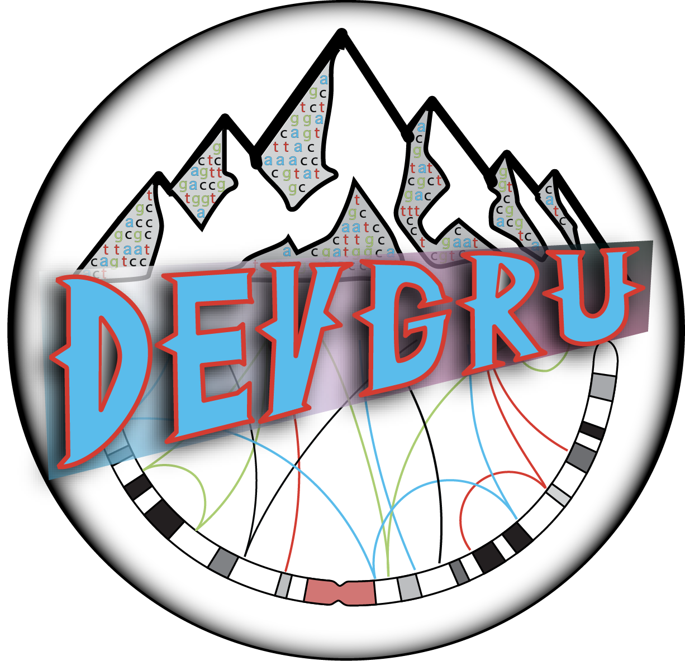

<!-- README.md is generated from README.Rmd. Please edit that file -->

# devgru 

<!-- badges: start -->

[](https://github.com/pblaney/devgru/issues)
[](https://github.com/pblaney/devgru/pulls)
[](https://lifecycle.r-lib.org/articles/stages.html#experimental)
[](https://github.com/pblaney/devgru/actions/workflows/pkgdown.yaml)
<!-- badges: end -->

A developmental `R` environment for a suite of `GenomicRanges` utilities

`devgru` provides tools for cancer genomics analysis within the
[`GenomicRanges`](https://bioconductor.org/packages/release/bioc/html/GenomicRanges.html)
universe: format-aware file readers, conversions between `data.table`,
`GRanges`, `GRangesList` and `GInteractions`, `seqinfo` harmonization,
chromosome-parallel workflows, copy number, structural variant, and
RNA-seq analysis helpers, QC diagnostics, and plotting. By default
everything is anchored to the autosomes and sex chromosomes of hg38 (see
`gUtils::hg_seqlengths()`).

Full documentation and the function reference are available at
<https://pblaney.github.io/devgru/>.

### Installation

You can install the current development version of `devgru` with:

``` r
devtools::install_github("pblaney/devgru")
```

Several dependencies are only available on GitHub
([`mskilab-org/gUtils`](https://github.com/mskilab-org/gUtils),
[`mskilab-org/fishHook`](https://github.com/mskilab-org/fishHook),
[`caravagnalab/easypar`](https://github.com/caravagnalab/easypar),
[`caravagn/pio`](https://github.com/caravagn/pio),
[`showteeth/ggpie`](https://github.com/showteeth/ggpie), and
[`pblaney/gGnome`](https://github.com/pblaney/gGnome)); these are
declared as `Remotes` and resolved automatically by
`devtools`/`remotes`. Packages listed under `Suggests` (e.g. `DESeq2`,
`fgsea`, `DNAcopy`, `InteractionSet`) are only needed for the specific
workflows that use them.

### Suite of Packages

The current suite of utilities for `devgru` can be quickly installed, if
needed, and loaded with:

``` r
library(devgru)
kit_loadout()

# Install/upgrade any missing or outdated packages in the kit first
kit_loadout(update_kit = TRUE)
```

#### GenomicRanges Core

- [`BSgenome.Hsapiens.UCSC.hg38`](https://bioconductor.org/packages/release/data/annotation/html/BSgenome.Hsapiens.UCSC.hg38.html)
- [`GenomicRanges`](https://bioconductor.org/packages/release/bioc/html/GenomicRanges.html)
- [`GenomeInfoDb`](https://bioconductor.org/packages/release/bioc/html/GenomeInfoDb.html)
- [`data.table`](https://cran.r-project.org/web/packages/data.table/vignettes/datatable-intro.html)
- [`mskilab-org/gUtils`](https://github.com/mskilab-org/gUtils)
- [`VariantAnnotation`](https://bioconductor.org/packages/release/bioc/html/VariantAnnotation.html)
- [`rtracklayer`](https://bioconductor.org/packages/release/bioc/html/rtracklayer.html)
- [`Biostrings`](https://bioconductor.org/packages/release/bioc/html/Biostrings.html)
- [`S4Vectors`](https://bioconductor.org/packages/release/bioc/html/S4Vectors.html)

#### Utility Core

- [`dplyr`](https://dplyr.tidyverse.org)
- [`stringr`](https://stringr.tidyverse.org)
- [`readr`](https://readr.tidyverse.org)
- [`ggplot2`](https://ggplot2.tidyverse.org)
- [`ggsci`](https://nanx.me/ggsci/)
- [`paletteer`](https://emilhvitfeldt.github.io/paletteer/)
- [`scico`](https://github.com/thomasp85/scico)
- [`flextable`](https://ardata-fr.github.io/flextable-book/index.html)
- [`mclust`](https://cran.r-project.org/web/packages/mclust/vignettes/mclust.html)
- [`parallel`](https://stat.ethz.ch/R-manual/R-devel/library/parallel/doc/parallel.pdf)
- [`doParallel`](https://cran.r-project.org/web/packages/doParallel/doParallel.pdf)
- [`foreach`](https://cran.r-project.org/web/packages/foreach/vignettes/foreach.html)
- [`R.utils`](https://cran.r-project.org/web/packages/R.utils/index.html)

### Function Overview

| Category | Functions |
|----|----|
| **Environment setup** | `kit_loadout()` loads the package kit; `chrompar()` runs a function in parallel by chromosome |
| **Readers** | `read_bed_file()`, `read_bedpe_file()`, `read_gtf_file()`, `read_maf_file()`, `read_vcf_file()` (output as `GRanges` or `data.table`), plus `aggregate_these()` to detect the format of and combine many files into one `data.table` |
| **Conversions** | `dt_to_gr()`, `dt_to_gi()`, `gi_to_dt()`, `gi_to_grl()`, `grl_to_gi()`, `gr_to_seg()` |
| **GenomicRanges utilities** | `gr_refactor_seqs()`, `grl_refactor_seqs()`, `gi_refactor_seqs()` to harmonize seqinfo; `gr_flank()` for boundary-aware flanking; `gr_sanitycheck()` and `dt_sanitycheck()` for input validation |
| **Copy number** | `get_fragcounter_segmentation()`, `get_cbs_per_chromosome()`, `get_cov_gap_imputation()`, `get_imputed_gaps_per_chromosome()`, `get_corrected_cnv_profile()` |
| **Mutations & structural variants** | `get_vaf()`, `get_maf_lite()`, `get_maf_nonsynonymous()`, `get_igh_trx_subtype()` (canonical IGH translocations in multiple myeloma) |
| **RNA-seq** | `get_deseq2_diff_expr()`, `get_fgsea_pathway_enrichment()`, `get_protein_coding_genes()` |
| **QC diagnostics** | `get_qc_diagnostics_alignment()` (Alfred), `get_qc_diagnostics_snvindel()`, `get_jabba_qc_diagnostic()` |
| **Plotting** | `geom_deseq2_volcano()`, `geom_gsea_enrichment()`, `geom_gap_imputation()`, `geom_jabba_stats()`, `copynumber_palettier()` |
| **CLI helpers** | `cli_stopwatch_start()`, `cli_stopwatch_end()`, `function_cli_intro()`, `cli_pio_colorscheme()` |

See the [reference
page](https://pblaney.github.io/devgru/reference/index.html) for full
details on each function.

### Quick Start

Read genomic files straight into harmonized `GRanges` (or a `data.table`
with `output_type = "dt"`):

``` r
library(devgru)

peaks_gr <- read_bed_file("peaks.bed.gz")
vcf_gr <- read_vcf_file("sample.vcf.gz", cpus = 4)
sv_dt <- read_bedpe_file("sample.bedpe")

# Collect and combine all MAFs in a directory into a single data.table
cohort_maf <- aggregate_these(path_to_files = "mafs/",
                              pattern_to_grab = "\\.maf$",
                              add_uniq_id = TRUE)
```

Harmonize seqinfo across objects, e.g. after lifting over from hg19 to
hg38:

``` r
GenomeInfoDb::seqinfo(example_dnase_hg38)
GenomeInfoDb::seqinfo(gr_refactor_seqs(example_dnase_hg38))
```

Add flanks to a region without crossing a boundary such as the
centromere:

``` r
notch2 <- gUtils::parse.gr("chr1:119911553-120069662")
chr1_p_arm <- gUtils::`%Q%`(chromosome_arms_hg38, seqnames == "chr1" & arm == "p")

gr_flank(input_gr = notch2,
         start_flank = 3e6,
         end_flank = 3e6,
         start_flank_boundary = GenomicRanges::start(chr1_p_arm),
         end_flank_boundary = GenomicRanges::end(chr1_p_arm))
```

Run larger workflows, such as CBS segmentation of a fragCounter read
depth profile parallelized by chromosome:

``` r
fragcounter_seg <- get_fragcounter_segmentation(
    path_to_fragcounter_profile = "sample.fragcounter.rds",
    cpus = 4)
```

### Bundled Data

`devgru` ships with hg38 reference annotations used internally by its
workflows, as well as small demo datasets for examples:

- **Reference genomic feature annotations**: `chromosome_arms_hg38`,
  `exclusion_regions_hg38`, `gene_body_hg38` (Ensembl v108),
- **Myeloma-specific genomic features**:
  `myeloma_translocation_ig_loci_hg38`,
  `myeloma_translocation_partner_loci_hg38`
- **Demo data**: DNase I hypersensitivity sites (`example_dnase_hg38`,
  `braf_dnase_demo_dt_hg19/hg38`, `kras_dnase_demo_gr_hg19/hg38`), a
  fragCounter read depth profile (`read_depth_demo_hg38`), and an
  RNA-seq counts matrix with condition labels
  (`hmcl_counts_demo_dt_hg38`, `hmcl_conditions_demo_dt_hg38`)

The raw files these were built from are in `inst/extdata/`.

### Citation

To cite `devgru` in publications, use:

``` r
citation("devgru")
```

### Contributing

Bug reports and feature requests are welcome on the [issue
tracker](https://github.com/pblaney/devgru/issues).
